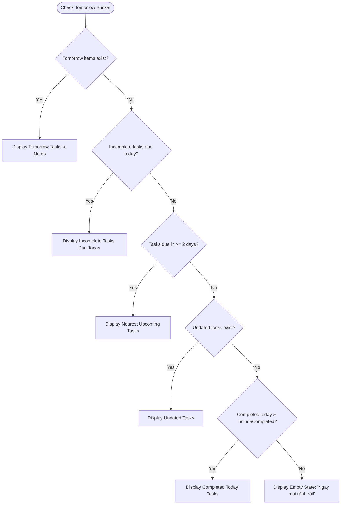

# Classroom Tracker - Codebase & Architecture Guide

Classroom Tracker is a native Google Classroom client and widget suite designed specifically around the Vietnamese school routine—namely **Báo bài Ngày mai** (evening prep for tomorrow's classes).

The project originates as a native Apple application (macOS menu bar / window with Dual-Pane SplitView + iOS / iPadOS with WidgetKit) and is ported with full architectural parity to native Android (Kotlin, Jetpack Compose, Jetpack Glance). Both platforms share an identical mental model, algorithmic core, reconciliation engine, and visual identity within this monorepo.

---

## Table of Contents

1. [Core Philosophy & Domain Invariants](#1-core-philosophy--domain-invariants)
2. [Domain Entities & Data Contracts](#2-domain-entities--data-contracts)
3. [Data Persistence & Cache Synchronization](#3-data-persistence--cache-synchronization)
4. [Google Classroom API, OAuth2 Security & Sync Reconciliation](#4-google-classroom-api-oauth2-security--sync-reconciliation)
5. [Vietnamese NLP, Search & Classification Engine](#5-vietnamese-nlp-search--classification-engine)
6. [UI Architecture & Design Systems](#6-ui-architecture--design-systems)
7. [Home Screen & Desktop Widgets](#7-home-screen--desktop-widgets)
8. [Repository Layout & Directory Map](#8-repository-layout--directory-map)
9. [Build, Testing & CI/CD Pipelines](#9-build-testing--cicd-pipelines)

---

## 1. Core Philosophy & Domain Invariants

If you work on this codebase, these non-negotiable architectural rules define how the application operates across all platforms.

### The "Tomorrow First" Mental Model (Báo bài)

In the Vietnamese school system, students pack their schoolbags in the afternoon or evening for the upcoming day. The traditional *sổ báo bài* (assignment notebook) is all about what must be brought and prepared for **Tomorrow**.

- **Today is considered done**: By the time an evening study session occurs, coursework due earlier today has already been turned in or handed over physically in class. Showing today's completed tasks on tomorrow's prep screen clutters the workspace.
- **The default landing screen is Tomorrow**: Both the primary application views and home screen widgets default directly to coursework due between the start of tomorrow (`00:00:00`) and the start of the day after (`23:59:59`).
- **Never default to "Today" or a flat "All Upcoming" list**: The landing view must always prioritize tomorrow's preparation.

### "Past Due Considered Done" Invariant

In accordance with the "Tomorrow First" philosophy, when an assignment's deadline has passed (`dueDate < now` on Apple / `dueEpochMillis < System.currentTimeMillis()` on Android), the app evaluates:

$$\text{isCompleted} \equiv \text{true}$$

Once a deadline expires, the task is considered concluded/expired in the context of prep rather than lingering as an active blocker. Furthermore, `isOverdue` strictly evaluates to `false`. This invariant is upheld across:
- Apple: `Coursework.swift` (`isCompleted` property, `isOverdue = false`)
- Android: `Coursework.kt` (`isCompleted` getter)

### Exact 6-Tier Fallback Hierarchy

When there are no assignments due tomorrow (`tomorrowFiltered.isEmpty`), the app falls back through a deterministic 6-tier waterfall:



1. **Tomorrow's bucket**: Coursework and standalone personal notes due tomorrow (`dueDate >= startOfTomorrow && dueDate < startOfDayAfter`). Completed tasks due tomorrow remain anchored in this tier alongside incomplete tasks when `includeCompleted == true`, preventing premature fallback.
2. **Incomplete tasks due today**: Tasks with `dueDate >= now && dueDate < startOfTomorrow` where `!isCompleted`.
3. **Nearest upcoming tasks**: Tasks due further out (`dueDate >= startOfDayAfter`), sorted chronologically.
4. **Undated tasks**: Assignments without a specified due date (`dueDate == null`).
5. **Completed today tasks**: ONLY evaluated if `includeCompleted == true`, and placed strictly as a last-resort fallback. Completed tasks due today **never** block or take precedence over upcoming tasks.
6. **All caught up empty state**: Clean illustration with Ember sleeping (`"Ngày mai rảnh rồi!"`).

### Local Completion Overrides Remote Sync

Students often finish physical worksheets or textbooks without submitting digital files on Google Classroom immediately. Both platforms allow ticking off a local completion checkbox (`isManuallyCompleted = true`).

- Background sync with Google Classroom **must not** revert a locally checked assignment back to `pending` or `late`.
- When Google Classroom confirms a task is completed remotely (`TURNED_IN` or `RETURNED`), `isManuallyCompleted` is reset to `false` because completion is now remotely acknowledged.
- If a teacher returns an assignment or a student un-submits remotely on Classroom web, and `isManuallyCompleted == false`, the task cleanly reverts to `pending`.

```
                    ┌─────────────────────────┐
                    │  Incoming Remote State  │
                    └────────────┬────────────┘
                                 │
           ┌─────────────────────┴─────────────────────┐
           ▼                                           ▼
   [Remote: TURNED_IN / RETURNED]              [Remote: PENDING / NEW]
           │                                           │
   Set status = .turnedIn / .returned         ┌────────┴────────┐
   Set isManuallyCompleted = false            ▼                 ▼
   (Acknowledged by server)        [Local isManuallyCompleted]  [Not manually done]
                                              │                 │
                                      Preserve .turnedIn    Revert to .pending
```

### Zero Mock Data on Widgets

The main app displays mock courses and sample assignments on first launch to demonstrate functionality before sign-in.

- Home screen widgets (iOS WidgetKit, macOS Widgets, Android Jetpack Glance) must **NEVER** display mock data.
- If the user is unauthenticated, widgets must display an explicit sign-in banner (`"Chạm để đăng nhập"`). Leaking mock data into widgets misleads students into believing they have assignments due.

### Google Classroom API Rate Limits (10 QPS)

The Google Classroom REST API enforces a strict per-user quota of **10 requests per second**. A student enrolled in 10 courses can easily trigger 20+ queries (courses, coursework, student submissions) if executed concurrently, causing HTTP 429 `RESOURCE_EXHAUSTED`.

All multi-course queries are throttled with the following batching protocol:
- Chunk active courses into batches of 3 (`chunkSize = 3`).
- Introduce an asynchronous delay of 200–250ms between chunks.
- Never execute unbounded parallel asynchronous calls across courses.

### Due Date & Timezone Handling

Google Classroom returns due dates in UTC as `{ year, month, day }` and due times as `{ hours, minutes, seconds }`.

1. **Explicit due time**: Parsed in UTC, then converted directly into device local timezone.
2. **Missing due time (`dueTime == null`)**: Google Classroom specification defines this as "due by end of day". In the user's local timezone, this is **23:59:59 local time**, NOT UTC midnight. Treating null as UTC midnight shifts deadlines by +7 hours in Vietnam (UTC+7), incorrectly shifting tasks to the next morning or previous night.
3. **Late-night badge formatting**: If a deadline is 23:55 or later, the UI displays `"Cuối ngày"` (End of Day) or `"Mai"` instead of `"23:59"`.

---

## 2. Domain Entities & Data Contracts

### Entity Parity Matrix

| Attribute / Model | Apple (`Shared/Models/`) | Android (`com.phucta.classroom.data.model`) | Notes |
|---|---|---|---|
| **Course** | `Course.swift` | `Course.kt` / `CourseEntity.kt` | Includes `isSelectedForWidget` toggle |
| **Coursework** | `Coursework.swift` | `Coursework.kt` / `CourseworkEntity.kt` | Denormalized `courseName`, `searchIndex` |
| **PersonalNote** | `PersonalNote.swift` | `PersonalNote.kt` / `PersonalNoteEntity.kt` | Standalone or linked via `courseworkId` |
| **ChecklistItem** | `ChecklistItem` | `ChecklistItem` | Embedded JSON or list with `isCompleted` |
| **SubmissionStatus** | `SubmissionStatus` | `SubmissionStatus` | `pending`, `turnedIn`, `returned`, `late` |

### Coursework Entity & State Specifications

- **`searchIndex`**: Pre-computed composite string combining diacritic-normalized title, course name, and description. Enables O(1) substring matching without on-the-fly string allocations.
- **`isManuallyCompleted`**: Boolean tracking whether completion was triggered locally by the student.
- **Pre-formatted Strings**: `timeOnlyString` and `formattedFullDueDate` are computed and cached upon decoding/initialization using thread-safe Gregorian formatters.

### Personal Notes Architecture (`PersonalNote`)

Students can create two varieties of personal notes:
1. **Standalone Notes** (`courseworkId == nil`): Independent study reminders, exam prep tasks, or supplies lists. If given a due date of tomorrow, they appear seamlessly in the Tomorrow homework stream.
2. **Attached Notes** (`courseworkId != nil`): Linked directly to a specific Google Classroom assignment. Displayed in the macOS/iOS Reader Pane and Android Bottom Sheet.

#### Checklist Completion Synchronization

Each `PersonalNote` contains an array of `ChecklistItem` entries:
- **Toggling checklist items**: When all checklist items are marked complete, `note.isCompleted` automatically transitions to `true`. Unchecking any item reverts `note.isCompleted` to `false`.
- **Attached checklist synchronization**: In the coursework reader pane and bottom sheet, ticking all checklist items in an attached note offers automatic coursework completion.
- **Pruning rule**: If an attached note has empty content (`content.trim().isEmpty()`) AND an empty checklist (`checklist.isEmpty()`), it is automatically deleted. However, if the note body is empty but checklist items exist, the note is **strictly preserved**.

#### Note Retention Across Sign-Out

User personal notes belong to the student, not Google Classroom. 
- Calling `signOut()` or clearing OAuth credentials preserves user notes by default (`includePersonalNotes: false`).
- Notes are only deleted if the user explicitly requests an application factory reset.

---

## 3. Data Persistence & Cache Synchronization

```
┌─────────────────────────────────────────────────────────────────────────────┐
│                             Apple Data Layer                                │
├──────────────────────────────────────┬──────────────────────────────────────┤
│ Multi-File App Group JSON Cache      │ Keychain Access Group                │
│ (group.com.phucta.classroom)         │ - access_token                       │
│ - cached_courses.json                │ - refresh_token                      │
│ - cached_coursework.json             │ - token_expiration                   │
│ - cached_classroom_personal_notes.json│                                      │
│ Backed by NSLock + serial ioQueue    │                                      │
└──────────────────────────────────────┴──────────────────────────────────────┘

┌─────────────────────────────────────────────────────────────────────────────┐
│                            Android Data Layer                               │
├──────────────────────────────────────┬──────────────────────────────────────┤
│ Room Database (ClassroomDatabase)    │ EncryptedSharedPreferences           │
│ - courses (CourseEntity)             │ (TokenStorage via MasterKey AES-GCM) │
│ - courseworks (CourseworkEntity)     │ - access_token                       │
│ - personal_notes (PersonalNoteEntity)│ - refresh_token                      │
│ Reactive via Kotlin Coroutines Flow  │ - expires_at                         │
├──────────────────────────────────────┴──────────────────────────────────────┤
│ Jetpack DataStore Preferences (ClassroomPreferences): user profile & sync   │
└─────────────────────────────────────────────────────────────────────────────┘
```

### Apple Persistence Architecture (`ClassroomStorage.swift`)

Apple platforms use an App Group container (`group.com.phucta.classroom`) accessible concurrently by the macOS application, iOS application, and WidgetKit extension processes:
- **Dual-tier caching**: An in-memory cache protected by `NSLock` provides microsecond reads. Persisted disk storage writes through a dedicated background serial `ioQueue`.
- **Timestamp consistency**: `cachedCoursesTimestamp` and `cachedCourseworkTimestamp` are stored in shared `UserDefaults`. If another process (e.g. background refresh) writes to disk, the in-memory cache detects the newer timestamp and reloads automatically.
- **Cross-process notification**: After saving data, `notifyWidgetReload()` posts notifications across Darwin notification centers (`com.phucta.classroom.widgetreload`) and triggers `WidgetCenter.shared.reloadAllTimelines()`.

### Android Persistence Architecture

Android employs standard Jetpack architecture components:
- **`ClassroomDatabase` (Room)**: Manages `CourseEntity`, `CourseworkEntity`, and `PersonalNoteEntity` with indexed foreign keys (`courseId`), due date indices, and transaction boundaries (`database.withTransaction`).
- **Reactive UI**: DAOs expose Kotlin `Flow<List<T>>`, allowing Compose screens and Glance widgets to observe data updates reactively.
- **Secure Token Storage (`TokenStorage`)**: OAuth2 tokens reside in `EncryptedSharedPreferences` backed by the Android KeyStore (`MasterKey.DEFAULT_AES256_GCM_SPEC`).
- **`WorkManager`**: Runs a periodic 15-minute background sync worker (`ClassroomSyncWorker`) to pull updates from Google Classroom.

---

## 4. Google Classroom API, OAuth2 Security & Sync Reconciliation

### OAuth 2.0 PKCE Architecture

Both platforms enforce standard RFC 7636 (Proof Key for Code Exchange) and RFC 8252 (OAuth 2.0 for Native Apps):

1. **Apple OAuth Flow**:
   - iOS: Uses `ASWebAuthenticationSession` with secure ephemeral browser sessions.
   - macOS: Spawns a lightweight local loopback server (`LoopbackOAuthServer.swift`) bound to `127.0.0.1` on an ephemeral port to receive the OAuth redirect cleanly.
2. **Android OAuth Flow**:
   - Uses `AppAuth-Android` via Android Custom Tabs with custom redirect URI schemes.
3. **Security Invariants**:
   - Zero hardcoded client secrets: Client applications must never package client secrets in app binaries.
   - CSRF State Token: A cryptographically random `state` token is generated per login attempt and verified upon callback. Mismatched states abort authorization immediately.
   - Pre-expiration Refresh: Tokens are automatically refreshed if within 60 seconds of expiration before making any API call.

### Reconciliation State Machine

During background sync, remote Google Classroom data merges with local cache using the following deterministic state machine:

```
Incoming Coursework Item:
  ├─ Match existing item by ID in local storage
  │   ├─ Found existing item:
  │   │   ├─ Case 1: Remote is TURNED_IN or RETURNED:
  │   │   │   └─ Accept remote status, set isManuallyCompleted = false
  │   │   ├─ Case 2: Remote is PENDING/NEW and existing.isManuallyCompleted == true:
  │   │   │   └─ Preserve local completion (status = .turnedIn, isManuallyCompleted = true)
  │   │   └─ Case 3: Remote is PENDING/NEW and existing.isManuallyCompleted == false:
  │   │       └─ Accept remote status (status = .pending, isManuallyCompleted = false)
  │   └─ New item:
  │       └─ Insert with remote status and isManuallyCompleted = false
  └─ Prune orphaned coursework not returned by active courses
```

---

## 5. Vietnamese NLP, Search & Classification Engine

### Diacritic Normalization Algorithm

Vietnamese students search using mixed diacritics (e.g. `"giai tich"`, `"toán"`, `"đại số"`). The search engine implements zero-allocation, table-driven diacritic stripping:

- **Character mapping table**: A pre-computed `CharArray(0x1F00)` maps all accented vowel variants (`à`, `á`, `ả`, `ã`, `ạ`, `ă`, `ắ`, `â`, `ấ`, etc.) to their ASCII counterparts, and maps `đ`/`Đ` directly to `d`.
- **Fast thread-safe cache**: High-frequency syllables (`toán`, `lý`, `hóa`, `sinh`, `bài tập`, `kiểm tra`) are resolved via an atomic reference array cache (`FastStringCache` / Swift dictionary cache).

### Search Relevance Scoring Matrix

Search queries are tokenized on whitespace and punctuation delimiters (`,`, `-`, `/`, `:`, `(`, `)`, `;`, `[`, `]`, `.`, `+`, `_`, `\u00A0`, `\u202F`) and scored using a weighted multi-tier algorithm:

| Match Type | Target Field | Points |
|---|---|---|
| **Exact Full Match** | Title (`normTitle == query`) | **+200** |
| **Prefix Match** | Title (`normTitle.startsWith(query)`) | **+120** |
| **Exact Full Match** | Course Name (`normCourse == query`) | **+100** |
| **Substring Match** | Title | **+80** |
| **School Acronym Match** | Query Acronym $\leftrightarrow$ Title Phrase (`btvn`, `kt`, `15p`, `45p`, `gk`, `ck`) | **+70** |
| **Prefix Match** | Course Name | **+60** |
| **Multi-Token All Title Match** | All query tokens present in Title ($K \ge 2$) | **+50** |
| **Token Word Boundary** | Title (isolated by word boundaries on both sides) | **+45** (+30 base + 15 bonus) |
| **Substring Match** | Course Name | **+40** |
| **Token Acronym Match** | Token Acronym $\leftrightarrow$ Title Phrase | **+35** |
| **Multi-Token Title/Course Match** | All query tokens present in Title or Course ($K \ge 2$) | **+25** |
| **Telex Fault-Tolerant Token** | Title (trailing tone key or doubled letter normalized) | **+20** (+10 word boundary) |
| **Token Match** | Course Name | **+15** |
| **Checklist Match** | Personal Note Checklist Items (`checklistTitles`) | **+10** |
| **Telex Fault-Tolerant Token** | Course Name | **+10** |
| **Token Match** | Content / Description | **+5** |

### Algorithmic Refinements: Acronyms, Telex & Boundary Isolation

1. **School Acronyms & Synonyms Expansion (`expandVietnameseAcronyms`)**:
   - High school coursework frequently uses Vietnamese educational abbreviations.
   - The search indexer enriches `searchIndex` with bidirectional expansions:
     - `btvn` $\leftrightarrow$ `bai tap ve nha`
     - `kt` $\leftrightarrow$ `kiem tra`
     - `15p` $\leftrightarrow$ `15 phut`
     - `45p` $\leftrightarrow$ `45 phut`
     - `gk` $\leftrightarrow$ `giua ki` / `giua ky`
     - `ck` $\leftrightarrow$ `cuoi ki` / `cuoi ky`
     - `th` $\leftrightarrow$ `thuc hanh`
     - `cd` $\leftrightarrow$ `chuyen de`
     - `sgk` $\leftrightarrow$ `sach giao khoa`
     - `sbt` $\leftrightarrow$ `sach bai tap`
   - Searching `btvn` instantly matches assignments titled `"Bài tập về nhà..."`, and searching `"bài tập về nhà"` matches `"BTVN..."`.

2. **True Two-Sided Word Boundary Isolation (`findWordBoundary` / `isWordAt`)**:
   - Enforces separation from alphanumeric characters on both start and end boundaries (`isWordAt(offset, len)`).
   - Eliminates false positive word boundary bonuses (e.g. `tin` inside `tinh than`, or `van` inside `vanban`).

3. **Telex Typing Slip Tolerance (`cleanTelexKeystrokes`)**:
   - Accommodates typing transpositions and unmerged Telex tone marks (e.g. `toans` $\to$ `toan`, `baif` $\to$ `bai`, `ddai` $\to$ `dai`).
   - Evaluated as a graceful fallback only when the raw token does not match, preserving exact-string precedence and zero regression on English vocabulary (e.g. `physics`, `class`).

### Subject Taxonomy & Classification (`SubjectArtHelper`)

Course titles on Google Classroom vary wildly between schools. `SubjectArtHelper` categorizes course titles strictly into the **11 core Vietnamese High School curriculum subjects (Chương trình GDPT)**, falling back to `.other` for any non-curriculum course:

```
┌────────────────────┬───────────┬───────────────────┬────────────────────────────────────────────────────────┐
│ Subject            │ Badge     │ Theme Color       │ Key Word Boundaries & Guard Exclusions                 │
├────────────────────┼───────────┼───────────────────┼────────────────────────────────────────────────────────┤
│ Tin học (CS)       │ TIN       │ Cyan (#14AD8A)    │ tin học, lập trình, cntt, it, ctdl, c++, python, csdl. │
│                    │           │                   │ Guard: thông tin, bản tin, tin tức, niềm tin, tự       │
│ Toán (Math)        │ TOÁN      │ Amber (#F2991A)   │ toán, giải tích, đại số, hình học, xác suất, thống kê. │
│                    │           │                   │ Guard: điện toán, an toàn, thanh toán, hoàn toàn       │
│ Tiếng Anh (English)│ ANH       │ Blue (#2694EB)    │ tiếng anh, english, ielts, toeic, toefl.               │
│                    │           │                   │ Guard: hình ảnh, âm thanh, thầy, cô, gv                │
│ Ngữ văn (Lit)      │ VĂN       │ Coral (#EB6138)   │ ngữ văn, tiếng việt, văn.                              │
│                    │           │                   │ Guard: văn phòng, văn hóa/văn hoá, văn minh, luận văn  │
│ Vật lý (Physics)   │ LÝ        │ Violet (#7361E0)  │ vật lý/vật lí, cơ học, nhiệt học, quang học, điện từ.  │
│                    │           │                   │ Guard: quản lý, xử lý, tâm lý, pháp lý, địa lý, hợp lý │
│ Hóa học (Chem)     │ HOÁ       │ Pink (#DC47AD)    │ hóa học/hoá học, hóa hữu cơ, hóa vô cơ, hóa đại cương. │
│                    │           │                   │ Guard: tự động hóa, văn hóa, hóa đơn, hòa bình, hóa thân│
│ Sinh học (Biology) │ SINH      │ Green (#33B866)   │ sinh học, di truyền, tế bào, vi sinh, sinh thái.       │
│                    │           │                   │ Guard: học sinh, sinh viên, sinh hoạt                  │
│ Lịch sử (History)  │ SỬ        │ Red-Amber (#D98529│ lịch sử, sử 10-12.                                     │
│                    │           │                   │ Guard: sử dụng, lịch sự, lịch sự trong giao tiếp       │
│ GDQP (Defense Edu) │ GDQP      │ Forest (#299447)  │ giáo dục quốc phòng, gdqp, an ninh quốc phòng, quân sự │
│ GDĐP (Local Edu)   │ GDĐP      │ Teal (#0D9488)    │ giáo dục địa phương, gddp, gdđp, giáo dục đp           │
│ HĐTN (Experiential)│ HĐTN      │ Orange (#F26C1F)  │ hoạt động trải nghiệm, hdtn, hđtn, hướng nghiệp,       │
│                    │           │                   │ sinh hoạt dưới cờ, sinh hoạt lớp                       │
│ Khác (Other)       │ Prefix/MÔN│ Slate (#6685A3)   │ Fallback: Geography, Economics, Networking, Art, etc.  │
└────────────────────┴───────────┴───────────────────┴────────────────────────────────────────────────────────┘
```

#### Deterministic Static Badge Codes & Memory Efficiency
- All 11 curriculum subjects have static, compile-time $O(1)$ badge codes (`TIN`, `TOÁN`, `ANH`, `VĂN`, `LÝ`, `HOÁ`, `SINH`, `SỬ`, `GDQP`, `GDĐP`, `HĐTN`).
- Only `.other` computes dynamic badges based on the first 3 characters of course/title or falls back to `MÔN`.
- On Android, `SubjectArtHelper.theme(...)` reuses pre-allocated `STANDARD_THEMES[cat.ordinal]` instances with zero object allocation during list scrolling.

#### Homeroom Class & Assignment Title Priority
In Vietnamese high schools, homeroom teachers frequently create a single Google Classroom for the entire class (e.g. `"11 Tin"` or `"12 Chuyên Anh"`), and subject teachers post assignments inside it (e.g. `"Toán (tuần 7)"`, `"Lý bài tập 10"`).
- `SubjectArtHelper.category(courseName, title)` prioritizes explicit subject identifiers in the assignment `title` over generic homeroom class names.
- Example: Course `"11 Tin"` with title `"Toán (tuần 7)"` cleanly classifies as **`MATH`** (`TOÁN`), not `COMPUTER_SCIENCE`.

#### Strict False Positive Guards
Vietnamese compound words can easily cause misclassification:
- `"LÝ"` must **NOT** match `"quản lý"` (management), `"xử lý"` (processing), `"tâm lý"` (psychology), or `"địa lý"` (geography).
- `"HOÁ"` must **NOT** match `"văn hóa"` / `"văn hoá"` (culture), `"hóa đơn"` (invoice), `"tự động hóa"` (automation), or `"hòa bình"` (peace).
- `"SỬ"` must **NOT** match `"sử dụng"` (usage), `"lịch sự"` (polite), or `"lịch sự trong giao tiếp"`.
- `"VĂN"` must **NOT** match `"văn phòng"` (office), `"văn hóa"` (culture), `"văn minh"` (civilization), or `"luận văn"` (thesis).
- `"ANH"` must **NOT** match `"hình ảnh"` (image), `"âm thanh"` (audio), `"thầy"`, `"cô"`, or `"gv"` (teacher names).
- `"TIN"` must **NOT** match `"thông tin"` (information), `"bản tin"` (newsletter), `"tin tức"` (news), or `"niềm tin"` (trust).
- `"TOÁN"` must **NOT** match `"điện toán"` (computing), `"an toàn"` (safety), `"thanh toán"` (payment), or `"hoàn toàn"` (completely).

---

## 6. UI Architecture & Design Systems

### Design Philosophy: Daylight Paper & Modernist Artwork

- **Light Mode Only**: The app is purposefully locked to a daylight paper aesthetic (`ChunkyDaylightPalette`). Dark mode and Android dynamic Material You recoloring are disabled to preserve contrast on editorial SVG art and colored subject badges.
- **Mascot (Ember)**: A hand-drawn flame character expressing five distinct emotional states:
  - `normal`: Everyday resting state.
  - `stressed`: Homework due in under 12 hours.
  - `studying`: Viewing assignment details.
  - `celebrating`: Ticking off an assignment or finishing all tasks.
  - `sleeping`: All caught up empty state (`"Ngày mai rảnh rồi!"`).

### Apple Liquid Glass Adaptive Architecture (`AppleLiquidGlass.swift`)

On Apple platforms, UI components adapt dynamically to the host OS version and compiler toolchain:

```swift
#if (os(macOS) || os(iOS)) && compiler(>=6.4)
if isEnabled && AppleOSDetector.supportsLiquidGlass {
    if #available(iOS 26.0, macOS 26.0, *) {
        self.glassEffect(.regular, in: shape)
    }
}
#endif
```

- **macOS 26+ & iOS 26+**: Renders native Apple Liquid Glass surfaces with interactive lighting and tinted specular reflections (`.glassEffect`).
- **iOS 17 & Xcode 15**: Gracefully falls back to `.ultraThinMaterial` and rounded paper cards with subtle borders (`ChunkyTheme.editorialCardBorder`), guaranteeing 100% build compatibility on legacy CI runners.
- **`AppleOSDetector`**: Exposes diagnostic states (`"Apple Liquid Glass SDK"`, `"Apple OS Material Fallback"`, `"Standard Daylight Palette"`).

### Platform Layout Implementations

- **macOS**: Dual-pane SplitView (`ContentView.swift` and `HomeworkReaderPane.swift`). Left pane displays the filtered coursework list with sticky section headers; right pane provides an inline assignment reader with attached personal notes, checklists, and direct Google Classroom launch actions.
- **iOS**: Single-pane navigation driven by an interactive tactile switch bar (`SwitchNavBar.swift`) with haptic feedback (`PlatformHaptics`).
- **Android**: Jetpack Compose screen suite (`TomorrowHomeworkScreen.kt`, `AllUpcomingScreen.kt`, `CompletedHomeworkScreen.kt`, `PersonalNotesScreen.kt`) with an expandable `HomeworkDetailBottomSheet.kt`.

### Evening Reminder Notification Routine

The app includes an integrated notification service (`EveningReminderService.swift` on Apple / WorkManager notification on Android):
- Schedules a daily local notification at **20:00** (8:00 PM local time).
- Prompts the student: *"Sổ báo bài ngày mai đã sẵn sàng! Kiểm tra các bài tập và ghi chú cần chuẩn bị cho ngày mai nhé."*
- Notification payload includes the exact count and subject badges of tomorrow's assignments.

---

## 7. Home Screen & Desktop Widgets

```
┌────────────────────────────────────────────────────────┐
│                   Widget Data Flow                     │
└──────────────────────────┬─────────────────────────────┘
                           │
                 [ClassroomStorage]
                 Filter: isSelectedForWidget == true
                 Exclude: Mock Data if logged out
                           │
             ┌─────────────┴─────────────┐
             ▼                           ▼
     [Apple WidgetKit]          [Android Jetpack Glance]
     - SmallWidgetView          - ClassroomGlanceWidget
     - MediumWidgetView         - EmberWidgetBitmapHelper
     - LargeWidgetView          - Periodic WorkManager update
     - WidgetVectorArt          - updateAll(context)
```

- **Apple WidgetKit**: Provides Small, Medium, and Large widgets with native timeline generation via `ClassroomTimelineProvider`. Utilizes custom CoreGraphics vector paths (`WidgetVectorArt.swift`) to render crisp subject icons and Ember mascot illustrations without raster scaling artifacts.
- **Android Jetpack Glance**: Built with `GlanceAppWidget`. Because Glance does not support arbitrary vector Compose canvases directly, Ember illustrations are rasterized into optimized, cached bitmaps via `EmberWidgetBitmapHelper`.
- **Course Selection Filtering**: Widgets strictly respect the `isSelectedForWidget` boolean on each course. Inactive or unselected courses are omitted from widget timelines.

---

## 8. Repository Layout & Directory Map

```
classroom/
├── ClassroomApp/                   # Apple Application (macOS & iOS)
│   ├── ClassroomApp.swift          # App entry point, scene setup, split view configuration
│   ├── Views/
│   │   ├── ContentView.swift       # Primary landing view, navigation coordinator
│   │   ├── HomeworkReaderPane.swift# Desktop & tablet dual-pane reading view
│   │   ├── PersonalNotesView.swift # Notes list, editor, and checklist management
│   │   ├── AssignmentListRow.swift # Homework card row with completion toggle
│   │   ├── CompactCourseFilterSheet.swift # Course selection and widget visibility modal
│   │   ├── SettingsSheetView.swift # Account, reminder, and sync preferences
│   │   └── FloatingToastHUD.swift  # Non-intrusive action feedback toasts
│   └── Assets.xcassets             # Editorial illustrations, app icons, color sets
│
├── ClassroomWidget/                # Apple WidgetKit Extension
│   ├── ClassroomWidgetBundle.swift # Widget bundle registration
│   ├── ClassroomTimelineProvider.swift # Timeline provider, refresh schedules
│   └── ClassroomWidget.swift       # Widget configurations
│
├── Shared/                         # Shared Apple Core (App + WidgetKit)
│   ├── Models/
│   │   ├── Course.swift            # Course model, widget selection flags
│   │   ├── Coursework.swift        # Assignment model, status, search indexing
│   │   └── PersonalNote.swift      # Personal note model, checklist synchronization
│   ├── Storage/
│   │   └── ClassroomStorage.swift  # App Group multi-file cache, thread-safe access
│   ├── Network/
│   │   ├── GoogleOAuthService.swift# ASWebAuthenticationSession, PKCE, Keychain
│   │   ├── LoopbackOAuthServer.swift# macOS RFC 8252 local socket server
│   │   └── ClassroomAPIService.swift# Throttled Google Classroom REST API client
│   ├── Notifications/
│   │   └── EveningReminderService.swift # Local 20:00 evening notification manager
│   ├── WidgetViews/
│   │   ├── AppleLiquidGlass.swift  # Adaptive Liquid Glass styling & fallbacks
│   │   ├── ChunkyTheme.swift       # Daylight paper palette and typography
│   │   ├── ChunkyEmberCharacterView.swift # Procedural vector mascot renderer
│   │   ├── WidgetSharedViews.swift # SubjectArtHelper, category recognition
│   │   ├── WidgetVectorArt.swift   # High-resolution vector scenes for widgets
│   │   ├── SmallWidgetView.swift   # Compact widget layout
│   │   ├── MediumWidgetView.swift  # Standard horizontal widget layout
│   │   └── LargeWidgetView.swift   # Expanded multi-item widget layout
│   └── PlatformUICompat.swift      # Cross-platform colors, haptics, OS detection
│
├── android/                        # Native Android Application
│   ├── gradle/
│   │   └── libs.versions.toml      # Dependency catalog (Compose, Room, Glance)
│   └── app/src/
│       ├── main/
│       │   ├── AndroidManifest.xml # Permissions, AppAuth redirect URI schemes
│       │   └── java/com/phucta/classroom/
│       │       ├── ClassroomApplication.kt # Application lifecycle, cache eviction
│       │       ├── data/
│       │       │   ├── local/      # Room DB, DAOs, DataStore, TokenStorage
│       │       │   ├── model/      # Entities, date utilities, Vietnamese search
│       │       │   ├── remote/     # Retrofit REST service, AppAuth OAuth manager
│       │       │   └── repository/ # ClassroomRepository, sync & reconciliation
│       │       ├── domain/         # BaoBaiBucketingUtils, BaoBaiShareHelper
│       │       ├── ui/
│       │       │   ├── components/ # AssignmentCard, EmberCanvas, SubjectBadge
│       │       │   ├── screens/    # Tomorrow, AllUpcoming, Notes, Settings
│       │       │   └── theme/      # Color tokens, typography, shapes
│       │       ├── widget/         # Glance widgets & Ember bitmap helper
│       │       └── worker/         # WorkManager 15-minute background sync
│       └── test/                   # Comprehensive JUnit unit & benchmark tests
│
├── Tests/                          # Apple Core Logic & Benchmark Test Suites
│   ├── AppleCoreLogicTests.swift   # Standalone CLI test suite for Apple core
│   └── AppleBenchmarkTests.swift   # Swift performance benchmarks
│
├── scripts/                        # Automated build and packaging scripts
│   ├── build_all.sh                # Master multiplatform build script
│   ├── build_pkg.sh                # macOS application packager (.pkg)
│   ├── build_ipa.sh                # iOS application archiver (.ipa)
│   └── build_apk.sh                # Android release APK builder (.apk)
│
├── project.yml                     # XcodeGen project specification for Apple builds
├── CODEBASE.md                     # This file
└── README.md                       # Project overview
```

---

## 9. Build, Testing & CI/CD Pipelines

### Apple Platforms Build Setup

Apple targets are managed using [XcodeGen](https://github.com/yonaskolb/XcodeGen) via `project.yml`:
- **macOS Target**: Exclusively macOS 27 (`27.0`).
- **iOS Target**: iOS 17.0 -> 27.0 (Deployment target iOS 17.0).

```bash
# Generate the Xcode project
xcodegen generate

# Build macOS Package (.pkg)
./scripts/build_pkg.sh

# Archive iOS Application (.ipa)
./scripts/build_ipa.sh
```

### Android Build Setup

Android utilizes Gradle with version catalogs (`android/gradle/libs.versions.toml`) targeting Java 17, minSdk 26, targetSdk 34:

```bash
cd android

# Build debug APK
./gradlew assembleDebug

# Build signed release APK
./gradlew assembleRelease
# Or use the convenience script from repository root:
./scripts/build_apk.sh
```

### Verification & Test Execution

Before submitting any code changes, all test suites must pass without errors.

#### 1. Running Apple Core Logic Tests
The standalone Swift test suite verifies bucketing, local completion overrides, search scoring, personal note retention, and subject categorization:

```bash
swiftc Tests/AppleCoreLogicTests.swift \
  Shared/Models/Course.swift \
  Shared/Models/Coursework.swift \
  Shared/Models/PersonalNote.swift \
  Shared/Models/BaoBaiShareHelper.swift \
  Shared/Storage/ClassroomStorage.swift \
  Shared/PlatformUICompat.swift \
  Shared/WidgetViews/ChunkyTheme.swift \
  Shared/WidgetViews/AppleLiquidGlass.swift \
  Shared/WidgetViews/WidgetVectorArt.swift \
  Shared/WidgetViews/ChunkyEmberCharacterView.swift \
  Shared/WidgetViews/WidgetSharedViews.swift \
  -o /tmp/test_runner && /tmp/test_runner
```

#### 2. Running Android Unit Tests & Benchmarks
The Android test suite validates Room DAOs, `BaoBaiBucketingUtils`, `VietnameseSearchUtils`, and OAuth token security contracts:

```bash
cd android && ./gradlew test
```

### Continuous Integration & Deployment (`.github/workflows/build.yml`)

The repository runs an automated GitHub Actions pipeline on all pushes to `main`, pull requests, tags, and manual triggers:
- Builds `ClassroomTracker.pkg` (macOS 27).
- Archives `ClassroomTracker.ipa` (iOS 17 -> 27).
- Builds `ClassroomTracker.apk` (Android release).
- Automatically publishes release assets to GitHub Releases when tagged with `v*`.
